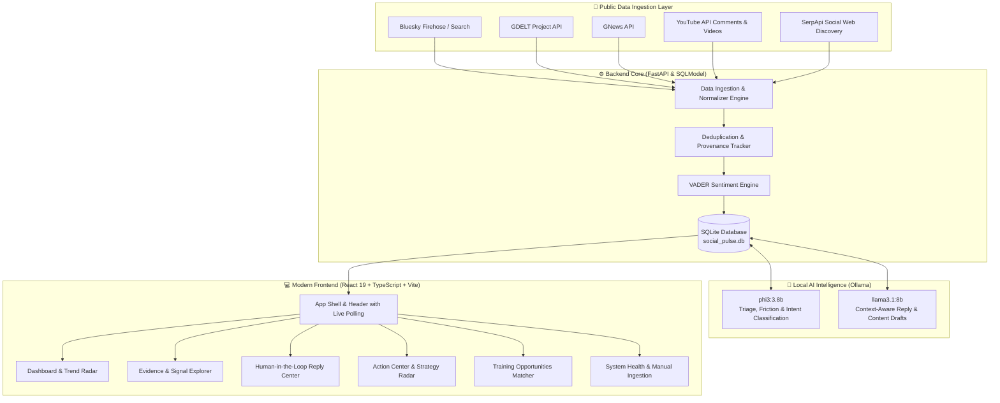

<div align="center">

# 📊 Social Pulse
### *Evidence-First Social Listening & PR Intelligence Copilot for Skill Development & Employability*

[](https://www.python.org/)
[](https://fastapi.tiangolo.com/)
[](https://react.dev/)
[](https://vitejs.dev/)
[](https://www.typescriptlang.org/)
[](https://ollama.ai/)
[](https://sqlmodel.tiangolo.com/)
[](https://tatastrive.com/)

<p align="center">
  <b>Social Pulse</b> transforms scattered public conversations into actionable, verified, and contextual intelligence. Built specifically for youth skill-development and vocational employability initiatives (initially spotlighting <b>Tata STRIVE</b>), it combines multi-channel public listening with private, local LLM evaluation and a human-in-the-loop decision console.
</p>

[Quickstart](#-quickstart-guide) • [Architecture](#-system-architecture) • [Key Features](#-core-capabilities) • [Configuration](#-configuration--environment-variables) • [Ethical Guardrails](#-ethical-governance--data-privacy)

---
</div>

## 📖 Executive Summary

**Social Pulse** operates as an intelligent PR and ecosystem copilot. Rather than treating social data as vanity metrics or autonomous reply bots, Social Pulse enforces an **evidence-first, human-in-the-loop pipeline**:

1. **Evidence Gathering:** Ingests public news and social signals from **Bluesky**, **GDELT Project**, **YouTube comments**, **GNews**, and **SerpApi**.
2. **Contextual Intelligence:** Runs local, private LLMs (`phi3:3.8b` and `llama3.1:8b` via Ollama) alongside VADER sentiment analysis to categorize audience intent, detect real friction points (fees, location, eligibility), and extract organizational collaboration cues.
3. **Strategic Action:** Surfaces heuristic opportunities in the **Action Center** and **Strategy Radar**, tracks communication objectives, links course offerings from the [official Tata STRIVE course catalogue](https://tatastrive.com/what-we-do/courses/), and produces review-only reply drafts.
4. **Safety & Ethics:** Strictly read-only to external networks. Approval in the Reply Center is a review decision—**no automated publishing occurs**.

---

## 🏛️ System Architecture



---

## ✨ Core Capabilities

### 1. 📡 Multi-Channel Public Signal Ingestion
- **Bluesky:** Real-time stream with dual-mode tracking: direct brand records (`Tata STRIVE`, `#tatastrive`) and broader thematic skills/employment stream with query provenance.
- **GDELT & GNews:** Validates global news coverage, verifying headlines and media publications with skills/employment context.
- **YouTube:** Quota-conscious comment monitoring across relevant videos and Google-discovered video candidate links, filtering substantive remarks.
- **SerpApi Social Discovery:** Runs configurable search queries across Reddit, X, Threads, Instagram, and LinkedIn snippets for learner and partner signals.

### 2. 🧠 Local AI & Sentiment Intelligence (Zero Cloud Leakage)
- **Local Ollama Runtime:** Zero cloud API costs or data leakage for intelligence tasks.
- **Audience Intent Lens:** Categorizes conversations by audience type (Learner, Job Seeker, Employer/Workforce, Ecosystem Partner, Community Supporter).
- **Friction Points Extraction:** Identifies real roadblocks: fees/costs, location accessibility, eligibility, language barriers, and placement trust.
- **Explainable Sentiment:** Blends VADER heuristic scoring with local LLM evaluation for balanced, nuanced assessments.

### 3. 🎯 Action Center & Strategy Radar
- **Triage & Accountability:** Categorizes questions, complaints, feedback, and high-priority conversations with assigned owners, follow-up dates, and status tracking.
- **Strategy Radar:** Automatically identifies prospective employer and institutional partners from public signals, assigning an explainable priority score, capability match summary, and tailored approach checklist.
- **Content Idea Studio:** Converts emerging conversational trends into evidence-linked content briefs with multi-angle copy generation.

### 4. ✍️ Human-in-the-Loop Reply Center
- **Strict Guardrails:** AI generates context-rich responses grounded strictly in verified source evidence and official programmes.
- **Review-Only Workflow:** Staff can evaluate, regenerate, refine, approve, or discard drafts. **The platform never posts autonomously to external networks.**

### 5. 🎓 Training Opportunities & Course Matcher
- Direct detection of learner questions regarding training centres, admissions, or skill courses.
- Automatically maps inquiries to the official [Tata STRIVE Course Catalogue](https://tatastrive.com/what-we-do/courses/) (e.g., Quick Service Restaurant, Auto Service, Retail, Electrical, BPO/BPM, Healthcare).

---

## 🛠️ Technology Stack

| Layer | Technology | Purpose |
|---|---|---|
| **Frontend** | React 19, TypeScript, Vite 8 | Ultra-fast, reactive SPA with accessible design tokens |
| **Styling** | Vanilla CSS + TailwindCSS 4 | Modern, glassmorphic UI with responsive dark/light palettes |
| **Icons** | Lucide React | Clean, consistent vector icon library |
| **Backend API** | FastAPI 0.115+, Uvicorn | High-performance asynchronous Python REST API |
| **Database & ORM**| SQLite, SQLModel (SQLAlchemy + Pydantic) | Typed schema management, robust local persistence |
| **Local AI Engine**| Ollama (`phi3:3.8b`, `llama3.1:8b`) | On-device NLP, intent parsing, and reply synthesis |
| **Sentiment** | VADER Sentiment Analysis | Fast, rule-based valence scoring for social texts |
| **Testing & Quality**| Pytest, Oxlint, TypeScript Compiler | Automated test suite and static analysis |

---

## 📂 Repository Structure

```text
social-pulse/
├── backend/
│   ├── app/
│   │   ├── main.py                # FastAPI entrypoint, middleware, routers
│   │   ├── config.py              # Environment configuration & defaults
│   │   ├── database.py            # SQLite connection & database initialization
│   │   ├── models.py              # SQLModel table definitions & schemas
│   │   ├── analysis.py            # Local Ollama AI & VADER sentiment pipelines
│   │   ├── reply_generator.py     # Grounded reply draft generation engine
│   │   ├── ingestion/             # Source connectors
│   │   │   ├── bluesky.py         # Bluesky public API connector
│   │   │   ├── gdelt.py           # GDELT Project news connector
│   │   │   ├── gnews.py           # GNews API connector
│   │   │   ├── youtube.py         # YouTube v3 comment & video collector
│   │   │   └── serpapi.py         # SerpApi Google social web discovery
│   │   └── routers/               # Modular REST API endpoints
│   ├── tests/                     # Backend test suite (pytest)
│   ├── requirements.txt           # Python backend dependencies
│   └── .env.example               # Backend environment template
├── frontend/
│   ├── src/
│   │   ├── App.tsx                # Main application orchestrator & shell
│   │   ├── components/            # UI components (Dashboard, Action Center, etc.)
│   │   ├── api.ts                 # Typed API client for FastAPI backend
│   │   ├── types.ts               # Shared TypeScript interfaces & types
│   │   └── index.css              # Custom styles & design system
│   ├── package.json               # Node.js dependencies and scripts
│   └── vite.config.ts             # Vite build & plugin configuration
├── .gitignore                     # Git ignore rules for virtualenvs, caches, secrets
└── README.md                      # Project documentation
```

---

## 🚀 Quickstart Guide

### Prerequisites
- **Operating System:** Windows 10/11, macOS, or Linux
- **Python:** Version 3.12 (`python --version` or `py -3.12 --version`)
- **Node.js:** Version 20.19+ or 22.12+ with npm (`node -v`, `npm -v`)
- **Ollama (Optional but Recommended):** Required for local AI classification and draft generation ([Download Ollama](https://ollama.ai))

---

### Step 1: Clone the Repository
```bash
git clone https://github.com/Tata-STRIVE/Hackathan-2.0-social_pulse-Team3.git
cd Hackathan-2.0-social_pulse-Team3
```

---

### Step 2: Backend Setup

1. **Create and activate a Python 3.12 virtual environment:**
   ```powershell
   # Windows (PowerShell)
   py -3.12 -m venv .venv
   .\.venv\Scripts\Activate.ps1

   # Linux / macOS
   python3.12 -m venv .venv
   source .venv/bin/activate
   ```

2. **Install backend dependencies:**
   ```bash
   pip install -r backend/requirements.txt
   ```

3. **Configure Environment Variables:**
   ```powershell
   # Copy example environment configuration
   cp backend/.env.example backend/.env
   ```
   *Edit `backend/.env` with your preferred API keys (see [Configuration Table](#-configuration--environment-variables)).*

4. **Run the Backend Server:**
   ```powershell
   cd backend
   python -m uvicorn app.main:app --reload --host 127.0.0.1 --port 8000
   ```
   - REST API: `http://127.0.0.1:8000`
   - Interactive Swagger Docs: `http://127.0.0.1:8000/docs`

---

### Step 3: Frontend Setup

1. **Open a new terminal window** and navigate to `frontend`:
   ```bash
   cd frontend
   npm install
   ```

2. **Start the Vite development server:**
   ```bash
   npm run dev
   ```
   - Access the dashboard at: `http://localhost:5173`

---

### Step 4: Setup Local AI (Ollama)

To enable local AI sentiment, friction extraction, and reply drafting:
```bash
# Pull the lightweight classification model
ollama pull phi3:3.8b

# Pull the high-fidelity generation model
ollama pull llama3.1:8b
```
Ensure the Ollama service is running (`ollama serve`). The backend health endpoint (`/health`) automatically monitors model readiness.

---

## ⚙️ Configuration & Environment Variables

Configure these settings in `backend/.env`:

| Variable | Default | Required? | Description |
|---|---|---|---|
| `DATABASE_URL` | `sqlite:///./social_pulse.db` | No | SQLite database location |
| `OLLAMA_URL` | `http://localhost:11434` | No | Ollama instance URL |
| `CLASSIFIER_MODEL` | `phi3:3.8b` | No | Model for categorization & friction detection |
| `REPLY_MODEL` | `llama3.1:8b` | No | Model for reply and content brief synthesis |
| `BLUESKY_WINDOW_DAYS` | `30` | No | Rolling search window for Bluesky public posts |
| `GNEWS_API_KEY` | *(None)* | Optional | API Key for GNews news headline aggregation |
| `YOUTUBE_API_KEY` | *(None)* | Optional | Google Cloud API Key for YouTube comment listening |
| `YOUTUBE_MAX_SEARCH_PAGES` | `1` | No | Quota control: Maximum video search pages per cycle |
| `YOUTUBE_SEARCH_INTERVAL_HOURS`| `6` | No | Hours between video queries to conserve quota |
| `SERPAPI_API_KEY` | *(None)* | Optional | SerpApi Key for Google social web snippet discovery |
| `SERPAPI_ENABLED` | `true` | No | Enable/disable SerpApi collector |
| `SERPAPI_THEMATIC_ENABLED` | `true` | No | Discover broader learner/NGO ecosystem signals |
| `CORS_ORIGINS` | `http://localhost:5173,...` | No | Allowed frontend origins |
| `LOG_LEVEL` | `INFO` | No | Logging verbosity (`DEBUG`, `INFO`, `WARNING`, `ERROR`) |

---

## 🔒 Ethical Governance & Data Privacy

Social Pulse was engineered from day one with strict ethical and responsible AI guidelines:

- **Public Data Only:** Ingests only publicly accessible data from authorized APIs (GDELT, Bluesky, YouTube, GNews, SerpApi). Does not circumvent paywalls or access private accounts.
- **Zero Autonomous Posting:** The system does not possess write-tokens or posting credentials for external social accounts. Human operators must explicitly review, adapt, and post any communications.
- **No Private Surveillance:** Search queries focus on institutional presence, workforce development themes, and public learner feedback. Individual privacy is respected and demographic profiling is not performed.
- **Quota & Resource Respect:** Conservative polling intervals, bounded batch processing, and caching prevent abusive request volumes on public data providers.
- **Local AI Privacy:** All LLM evaluations execute locally on user hardware via Ollama. No user or brand data is transmitted to third-party commercial LLM endpoints.

---

## 🧪 Testing & Verification

Run tests to ensure data pipelines and interface integrity:

```bash
# Backend unit & integration tests
cd backend
python -m pytest -q

# Frontend type verification & production build
cd frontend
npm run lint
npm run build
```

---

## 👥 Acknowledgements & Contributors

Developed as part of the **Tata STRIVE Hackathon 2.0** by **Team 3**.

- **Organization:** [Tata Community Initiatives Trust (TCIT) - Tata STRIVE](https://tatastrive.com/)
- **Mission:** Empowering India's youth through excellence in vocational training, skill-building, and digital employability innovation.
